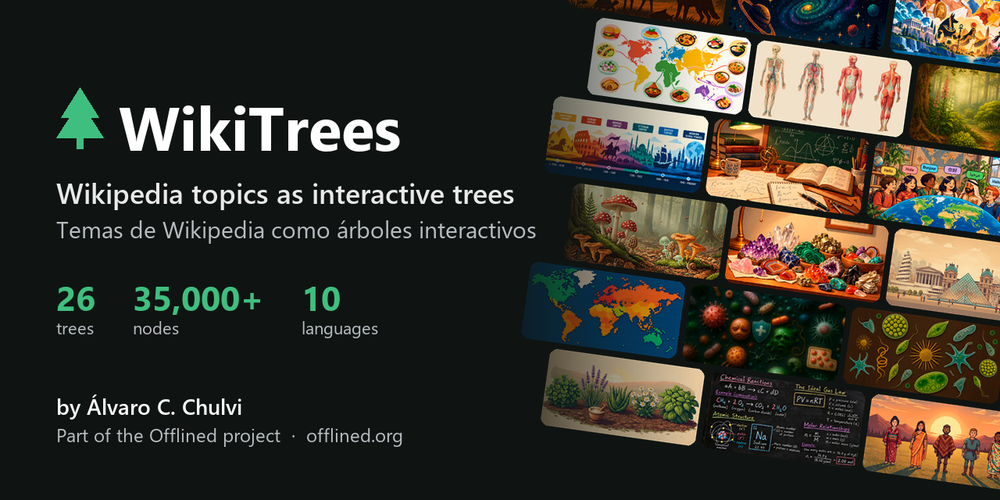

# 🌳 WikiTrees



**Wikipedia topics as interactive trees, in 10 languages.**
By **Álvaro C. Chulvi** · a project of **[Offlined](https://www.offlined.org)**

[English](#english) · [Español](#español)

---

## English

WikiTrees turns big areas of knowledge into trees you can explore: the animal kingdom, the human body,
the periodic table, world cuisines, mythologies, empires, mathematics from first grade to university…
Every node is linked to its **exact** Wikipedia article in each of the 10 languages
(English, Spanish, French, Portuguese, Italian, German, Russian, Chinese, Hindi and Arabic).

WikiTrees was born inside [Offlined](https://www.offlined.org), the app that brings Wikipedia and AI
to your computer without internet. This repository publishes the trees so anyone can use them.

### Try it

Open the viewer: **https://aruvaro-chulvi.github.io/OfflinedWikiTrees/**

Click a branch to unfold it and see its article summary, hover to see where it sits in the tree, search,
mark favourites and track your progress (saved in your browser).

To run it on your computer, serve the folder with any static web server, for example:

```bash
python -m http.server 8000
```

and open http://localhost:8000. (Opening `index.html` directly from disk does not work: browsers block
loading the tree files that way.)

### The trees

<!-- TREES:START -->
| | Tree | Category | Nodes |
|---|---|---|---:|
| 🦠 | **Animalia** — Animal kingdom classification. | Nature & Life | 3,584 |
| 🦠 | **Plantae** — Plant kingdom classification. | Nature & Life | 3,043 |
| 🦠 | **Fungi** — Classification of fungi (kingdom Fungi). | Nature & Life | 1,374 |
| 🦠 | **Protista** — Classification of protists (kingdom Protista). | Nature & Life | 630 |
| 🦠 | **Astronomical Bodies** — Planets, stars, galaxies and small bodies. | Nature & Life | 2,014 |
| 🦠 | **Dinosaur Classification** — Families, genera and notable species. | Nature & Life | 1,608 |
| 🧬 | **Human Body Parts** — Classification of external and internal parts. | Human Body & Health | 1,451 |
| 🧬 | **Viruses & Viral Diseases** — Families of viruses and related diseases. | Human Body & Health | 529 |
| 🧬 | **Diseases by body system** — Diseases grouped by the WHO ICD-10 chapters. Viral diseases are in “Viruses & Viral Diseases”. | Human Body & Health | 1,301 |
| 🧬 | **Medicines by class** — Active substances grouped by the WHO ATC classification. | Human Body & Health | 1,509 |
| 🌍 | **Continents, Countries & Capitals** — Hierarchical world geography. | Geography & Society | 1,611 |
| 🌍 | **World Languages** — Classification of languages and families. | Geography & Society | 1,390 |
| 🌍 | **Ethnicities & Cultures** — Classification of peoples, cultures and groups. | Geography & Society | 1,336 |
| 🧠 | **Branches of Knowledge** — Sciences, arts, humanities, technology. | Education & Knowledge | 1,384 |
| 🧠 | **Periodic Table** — Classification of the periodic table. | Education & Knowledge | 659 |
| 🧠 | **Mathematics** — Mathematics courses by age. | Education & Knowledge | 492 |
| 🧠 | **Physics** — Physics by level, from basic concepts to advanced physics. | Education & Knowledge | 345 |
| 🧠 | **Chemistry** — Chemistry by level, from matter and atoms to advanced chemistry. | Education & Knowledge | 328 |
| 🎨 | **Art Movements & Artists** — Painters, sculptors and architects. | Art & Entertainment | 1,524 |
| 🎨 | **World Museums** — Major museums by country and city. | Art & Entertainment | 1,312 |
| 🥗 | **World cuisines** — National cuisines of every continent and their best-known dishes, sweets, cheeses, sauces and drinks. | Food & Nutrition | 2,522 |
| 🥗 | **Nutrients** — Carbohydrates, proteins, fats, vitamins, minerals and phytochemicals, with their forms and the diseases caused by their deficiency. | Food & Nutrition | 301 |
| 🥗 | **Aromatic Plants** — Plants valued for their fragrance, flavor, or essential oils. | Food & Nutrition | 653 |
| 🧩 | **Minerals** — Classification of minerals. | Various & Curious | 924 |
| 🏛️ | **Mythologies of the world** — Gods, heroes, creatures and places from Greek, Norse, Egyptian, Hindu, Japanese, Aztec and other mythologies, plus a legendary bestiary. | History & Culture | 2,338 |
| 🏛️ | **Empires and civilizations** — Historical states, empires and civilizations from prehistory to the 20th century, by era and region and in chronological order. | History & Culture | 877 |
| | **26 trees** | | **35,039** |

*Nodes: in the language with the most articles.*
<!-- TREES:END -->

### Formats

Every tree comes in two flavours of the same JSON:

| Folder | Links point to | For |
|---|---|---|
| `trees/online/` | `https://<lang>.wikipedia.org/wiki/…` (checked against the live Wikipedia) | websites, apps with internet, the viewer |
| `trees/offlined/` | article titles of the [Kiwix](https://kiwix.org) Wikipedia ZIM files | offline use with Kiwix, as in Offlined |

`trees/<format>/index.json` lists the trees and their categories; `trees/images/` has the covers.

Each node looks like this:

```json
{
  "id": "optional stable id",
  "i18n": {
    "en": { "title": "Carbohydrate", "wiki": "Carbohydrate", "url": "https://en.wikipedia.org/wiki/Carbohydrate" },
    "es": { "title": "Glúcido", "wiki": "Glúcido", "url": "https://es.wikipedia.org/wiki/Glúcido" }
  },
  "noWiki": ["hi"],
  "children": [ ... ]
}
```

- `title`: name shown in that language.
- `wiki`: title of the Wikipedia article in that language (`url` only in the online format).
- `noWiki`: languages with no exact article for this node. Leaves without an article are hidden in that
  language; branches without an article stay as a label.
- The root of each file has an `about` block with the author, license and format.

### Community trees

Anyone can build a new tree — with the help of an AI assistant such as Claude — and send it. The maintainer
reviews every tree by hand; approved ones appear in the viewer under **🤝 Community** and can be downloaded
from **Offlined** (WikiTrees → *Community WikiTrees*).

1. Build it with the [prompt for your AI](community-kit/PROMPT.md), following the [format](community-kit/FORMAT.md)
   ([example](community-kit/example/vitamins.json)).
2. Check it with the [web checker](https://aruvaro-chulvi.github.io/OfflinedWikiTrees/community-kit/check.html).
3. Send it with the [“New community tree” form](https://github.com/Aruvaro-Chulvi/OfflinedWikiTrees/issues/new?template=new-tree.yml).

Everything is explained in [CONTRIBUTING.md](CONTRIBUTING.md). The official trees are not edited by the community.

### License

- **Trees and covers:** [CC BY-NC-SA 4.0](LICENSE) — use, share and adapt them for **non-commercial**
  purposes, crediting the author and sharing your changes under the same license.
- **Viewer code:** [PolyForm Noncommercial 1.0.0](LICENSE-CODE.md).
- **Community trees:** by their authors, each under the licence the author chose:
  [CC BY 4.0](https://creativecommons.org/licenses/by/4.0/) or [CC0 1.0](https://creativecommons.org/publicdomain/zero/1.0/). **Community tools** (`community-kit/`): MIT.
- **Commercial use** is reserved to the author: contact through [offlined.org](https://www.offlined.org).

Please credit it as: *WikiTrees by Álvaro C. Chulvi, a project of Offlined (https://www.offlined.org)*.
Details and third-party notices in [NOTICE.md](NOTICE.md).

---

## Español

WikiTrees convierte grandes áreas del conocimiento en árboles que se pueden explorar: el reino animal,
el cuerpo humano, la tabla periódica, las cocinas del mundo, las mitologías, los imperios, las matemáticas
desde primero de primaria hasta la universidad… Cada nodo enlaza con su artículo **exacto** de Wikipedia
en cada uno de los 10 idiomas (inglés, español, francés, portugués, italiano, alemán, ruso, chino, hindi y árabe).

WikiTrees nació dentro de [Offlined](https://www.offlined.org), la aplicación que lleva Wikipedia y la IA
a tu ordenador sin internet. Este repositorio publica los árboles para que cualquiera pueda usarlos.

### Pruébalo

Abre el visor: **https://aruvaro-chulvi.github.io/OfflinedWikiTrees/**

Haz clic en una rama para desplegarla y ver el resumen de su artículo, pasa el ratón para ver dónde está
en el árbol, busca, marca favoritos y sigue tu progreso (se guarda en tu navegador).

Para usarlo en tu ordenador, sirve la carpeta con cualquier servidor web estático, por ejemplo
`python -m http.server 8000`, y abre http://localhost:8000. (Abrir `index.html` directamente desde el disco
no funciona: los navegadores no dejan cargar así los archivos de los árboles.)

### Formatos

Cada árbol viene en dos versiones del mismo JSON:

- `trees/online/`: enlaces a `https://<idioma>.wikipedia.org/wiki/…`, comprobados contra la Wikipedia en línea.
- `trees/offlined/`: títulos de los artículos en los archivos ZIM de Wikipedia de [Kiwix](https://kiwix.org),
  para usarlos sin internet, como en Offlined.

El formato de cada nodo está explicado arriba, en la parte en inglés.

### Árboles de la comunidad

Cualquiera puede hacer un árbol nuevo —con ayuda de un asistente de IA como Claude— y enviarlo. El responsable
revisa cada árbol a mano; los aprobados aparecen en el visor en **🤝 Comunidad** y se pueden descargar desde
**Offlined** (WikiÁrboles → *WikiÁrboles de la comunidad*).

1. Hazlo con el [prompt para tu IA](community-kit/PROMPT.md), siguiendo el [formato](community-kit/FORMAT.md)
   ([ejemplo](community-kit/example/vitamins.json)).
2. Compruébalo con el [comprobador web](https://aruvaro-chulvi.github.io/OfflinedWikiTrees/community-kit/check.html).
3. Envíalo con el [formulario «Nuevo árbol de la comunidad»](https://github.com/Aruvaro-Chulvi/OfflinedWikiTrees/issues/new?template=new-tree.yml).

Todo está explicado en [CONTRIBUTING.es.md](CONTRIBUTING.es.md). La comunidad no modifica los árboles oficiales.

### Licencia

- **Árboles y portadas:** [CC BY-NC-SA 4.0](LICENSE): puedes usarlos, compartirlos y adaptarlos **sin fines
  comerciales**, citando al autor y compartiendo tus cambios con la misma licencia.
- **Código del visor:** [PolyForm Noncommercial 1.0.0](LICENSE-CODE.md).
- **Árboles de la comunidad:** de sus autores, cada uno con la licencia que eligió su autor:
  [CC BY 4.0](https://creativecommons.org/licenses/by/4.0/deed.es) o [CC0 1.0](https://creativecommons.org/publicdomain/zero/1.0/deed.es). **Herramientas de la comunidad** (`community-kit/`): MIT.
- **El uso comercial** queda reservado al autor: contacta a través de [offlined.org](https://www.offlined.org).

Cítalo así: *WikiTrees, de Álvaro C. Chulvi, un proyecto de Offlined (https://www.offlined.org)*.
Más detalles y avisos de terceros en [NOTICE.md](NOTICE.md).
